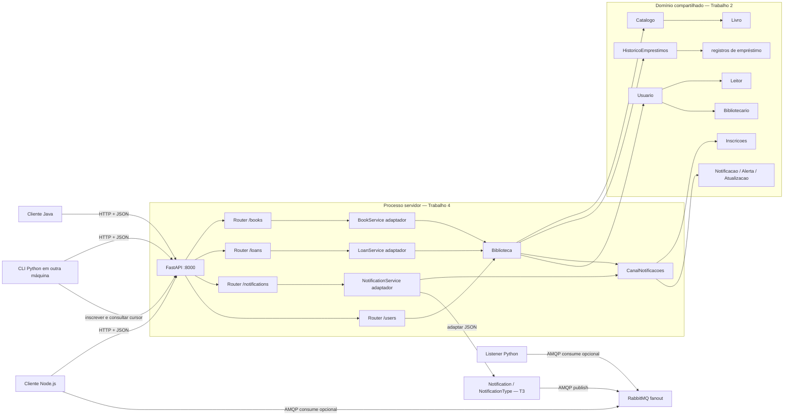
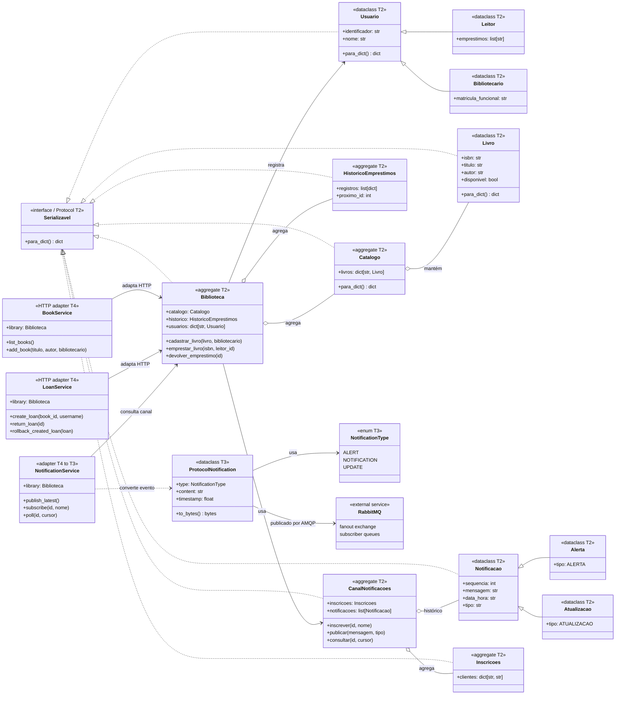
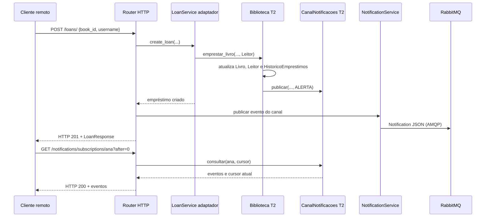

# Arquitetura, classes e orientação a objetos

O Trabalho 4 usa as classes de domínio do Trabalho 2 pela API HTTP. O pacote do
Trabalho 3 fornece o formato de eventos que o adaptador publica no RabbitMQ.
Os diagramas abaixo ficam no Markdown e podem ser visualizados pelo GitHub ou
por qualquer editor com suporte a Mermaid.

## Visão distribuída

A API e o CLI conversam por HTTP, inclusive quando estão em computadores
diferentes. O polling do CLI consulta o canal do processo servidor pelo cursor.
RabbitMQ é uma segunda rota de distribuição: clientes Node.js e o listener
Python podem consumir eventos diretamente.

## Diagrama de classes

## Fluxo de empréstimo

## Onde as classes entram

- **Herança:** `Leitor` e `Bibliotecario` especializam `Usuario`. `Alerta` e
  `Atualizacao` especializam `Notificacao`; a operação de domínio escolhe o
  subtipo e o adaptador preserva seu tipo ao converter o evento.
- **Agregação:** `Biblioteca` mantém `Catalogo` e `HistoricoEmprestimos`.
  `CanalNotificacoes` mantém `Inscricoes` e o histórico consultável de eventos.
- **Polimorfismo/serialização:** `Serializavel` é um `Protocol` do Python;
  `serializar()` aceita qualquer objeto que implemente `para_dict()`. Serviços
  e rotas chamam esse contrato para produzir dados JSON.
- **Estado compartilhado:** `get_library()` cria uma instância única. Os
  adaptadores de livro, empréstimo, notificação e usuário recebem esse mesmo
  `Biblioteca` por injeção de dependência; o empréstimo atualiza o livro que
  `/books/` lista.
- **Adaptação incremental:** os DTOs HTTP mapeiam `isbn/titulo/disponivel` para
  `id/title/available`. O adaptador de notificações converte `Notificacao` do
  Trabalho 2 para `Notification`/`NotificationType` do Trabalho 3 e chama o
  publicador RabbitMQ.

## Executar e validar

Inicie o servidor com `uv run uvicorn api.main:app --host 0.0.0.0 --port 8000`.
Em outro computador, conecte o [CLI Python](../cliente_cli/README.md) com
`python3 client.py --url http://IP_DO_SERVIDOR:8000 --username ana`; menu 9
inscreve e menu 10 consulta eventos. Os testes automatizados dos três projetos
estão descritos no [README do Trabalho 4](../README.md).
